**Guía Básica de Laboratorio**

**1.Objetivo de esta guía**

Desarrollar e implementar un entorno de laboratorio en GNS3 para la instalación, configuración y puesta en marcha de un firewall FortiGate, simulando un escenario de red con zonas WAN, LAN y DMZ, con el fin de comprender su funcionamiento, aplicar políticas de seguridad, habilitar servicios de red y garantizar la conectividad y protección frente a amenazas.

La creciente complejidad de las redes y el aumento constante de amenazas cibernéticas hacen indispensable el uso de firewalls de nueva generación que brinden seguridad avanzada y administración centralizada. FortiGate, como solución de seguridad integral, permite implementar políticas de control de acceso, filtrado de contenido, inspección de tráfico cifrado y segmentación de redes. La creación de un laboratorio en GNS3 proporciona un entorno seguro y controlado para experimentar con su instalación y configuración, permitiendo a los administradores y estudiantes de redes desarrollar habilidades prácticas, comprender la lógica de segmentación en zonas WAN, LAN y DMZ, y aplicar configuraciones que optimicen la seguridad y el rendimiento de la infraestructura de red sin comprometer entornos productivos.

**2.¿Qué es fortigate?**

Los Firewall Fortinet (también conocidos como firewalls de próxima generación NGFW o simplemente FortiGate) son dispositivos de seguridad que permiten la creación de redes seguras y proporcionan una protección amplia, integrada y automatizada contra amenazas emergentes y sofisticadas.

**Características de un FortiGate**

Cabe destacar que los FortiGate son bien conocidos tanto por su rendimiento como por su eficacia de seguridad, para tener más claro esto, veamos las siguientes características avanzadas con las que cuentan:

• **Control de aplicaciones:** Permite crear políticas rápidamente para permitir, denegar o restringir el acceso a aplicaciones o categorías completas de aplicaciones.

• **Prevención de intrusiones:** Protege contra intrusiones en la red mediante la detección y el bloqueo de amenazas antes de que lleguen a los dispositivos de red.

• **Antivirus:** Efectivo contra virus, software espía y otras amenazas a nivel de contenido.

• **Filtrado de URL:** Bloquea el acceso a sitios web maliciosos, pirateados

o inapropiados.

• **Sandboxing:** Es una solución avanzada de detección de amenazas para protegernos identificando malware previamente desconocido.

• **Inspección SSL:** Obtén visibilidad del tráfico cifrado y previene el malware.

Por otro lado, también existen algunas características que siguen siendo constantes, como, por ejemplo:

**1\.** La mayoría de los productos Fortinet están impulsados por los servicios de seguridad FortiGuard, garantizando que los clientes tengan la visibilidad y protección más recientes.

**2\.** Solo hay un sistema operativo en todas las plataformas Fortigate: nivel de

entrada, gama media y alta.

**3\.** Todos los dispositivos se pueden monitorear y administrar con facilidad usando FortiManager un único panel de administración.

**3.Instalar firewall fortinate en GNS3**

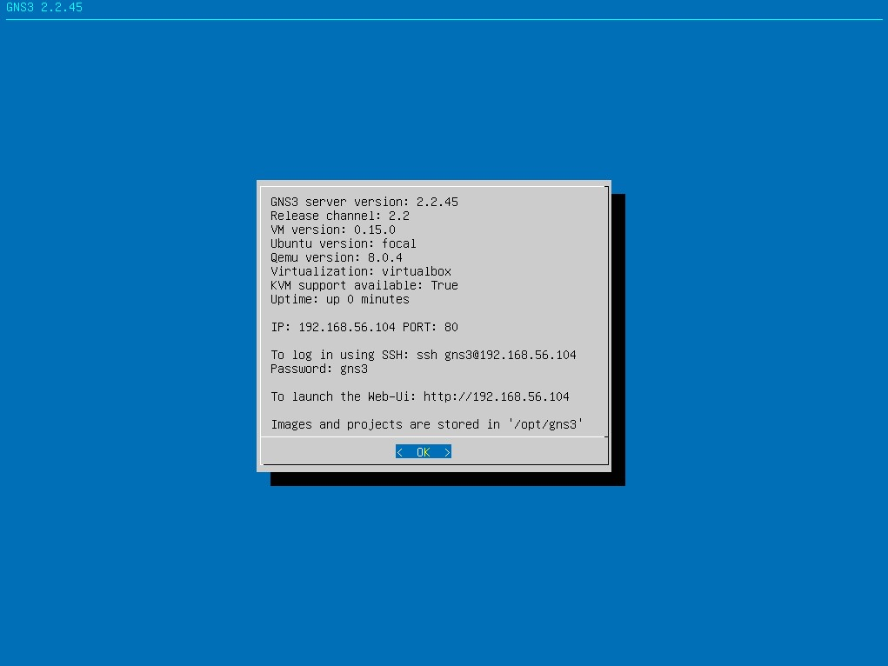

Para integrar el firewall fortinate en GNS3, debemos de tener descargada la máquina virtual de GNS3 en nuestro software de virtualización, en mi caso estoy utilizando Virtualbox, también debemos de tener habilitada la opción KVM support avilable para poder ejecutar el firewall de fortinate, también nos permitirá que el escenario tenga conexión con internet.

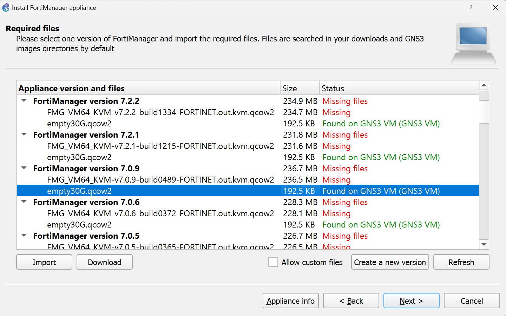

Ahora abrimos GNS3, y vamos a proceder a integrar el firewall fortigate, para ello debemos de tener descargada la imagen e instalarla, en este caso voy a utilizar la versión 7.0.9.

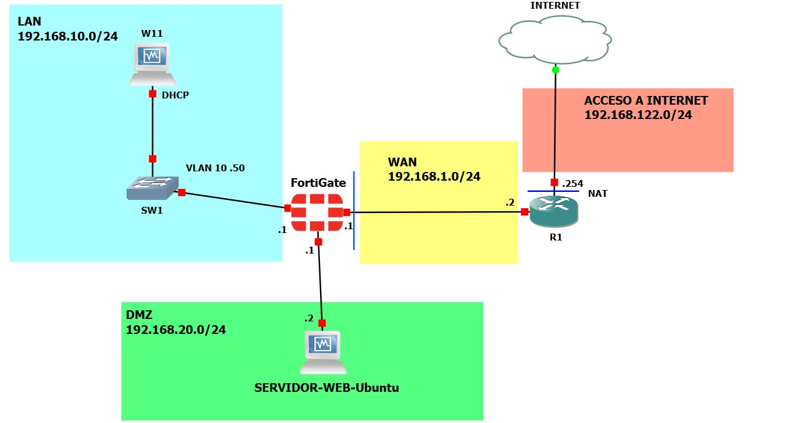

Una vez integrado el firewall Fortigate, vamos a crear un escenario de red, utilizando este firewall, el cual va a estar dividido en 3 zona, LAN para los clientes, DMZ para los servicios y WAN para acceso a internet, todo esto gestionado a través del firewall Fortigate, el direccionamiento será el siguiente:

| ZONA | DISPOSITIVO | INTERFAZ | DIRECCIONAMIENTO |
| --- | --- | --- | --- |
| WAN | R1 | f0/0 | 192.168.122.254/24 |
| f2/0 | 192.168.1.2/24 |  |  |
|  | Fortigate | port1 | 192.168.1.1/24 |
| port2 | 192.168.20.1/24 |  |  |
| port3 | 192.168.10.1/24 |  |  |
| DMZ | SV-Ubuntu | ethernet0 | 192.168.20.2/24 |
| LAN | SW1 | VLAN10CLIENTES | 192.168.10.50/24 |
| W11 | ethernet0 | DHCP: 192.168.10.100-192.168.10.200/24 |  |

**4.Configuración del escenario**

**4.1.Router R1**

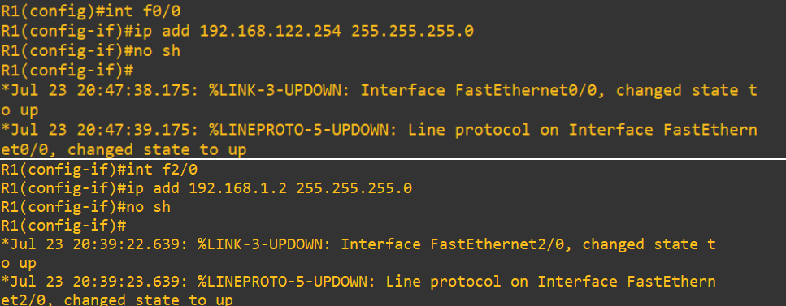

En primer lugar, vamos a proceder a configurar las interfaces del router R1, con los siguientes comandos.

conf t int f0/0

ip add 192.168.122.254 255.255.255.0

no sh

int f2/0

ip add 192.168.1.2 255.255.255.0 no sh

exit

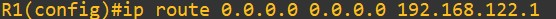

Ahora vamos a configurar una ruta estática predeterminada para que el escenario de la red pueda salir a internet.

ip route 0.0.0.0 0.0.0.0 192.168.122.1

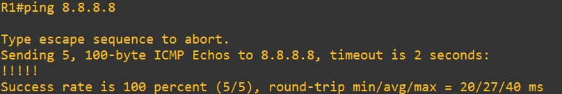

Vemos que haciendo ping a Google el router R1 ya tiene conexión a internet.

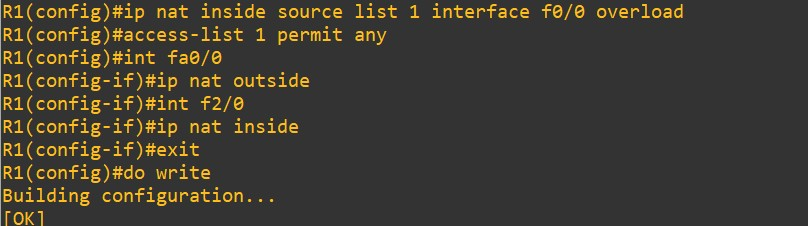

Ahora para que el resto de dispositivos de la red tengan acceso a internet, debemos de realizar un NAT/PAT con los siguientes comandos.

ip nat inside source list 1 interface f0/0 overload access-list 1 permit any

int fa0/0

ip nat outside int f2/0

ip nat inside

exit

do write

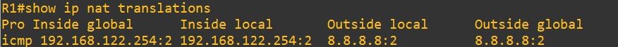

Comprobamos que el NAT está funcionado comprobando las tablas de traducciones NAT, con el siguiente comando.

show ip nat translations

**4.2.SV-Ubuntu**

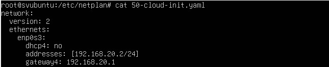

Ahora vamos a proceder a configurar el direccionamiento del SV-Ubuntu, para ellos debemos de editar el fichero de configuración de la red, que se encuentra en el directorio /etc/netplan.

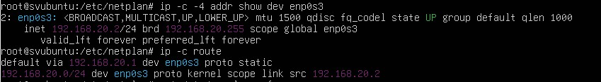

Vemos que se encuentra el direccionamiento asignado en la interfaz.

**4.3.Switch SW1**

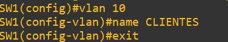

Ahora vamos a proceder a configurar el switch SW1 de la zona LAN, lo primero vamos a crear la VLAN y asignarle el nombre.

conf t vlan 10

name CLIENTES

exit

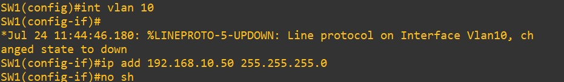

Ahora asignamos la dirección IP a la interfaz de la VLAN10.

int vlan 10

ip add 192.168.10.50 255.255.255.0 no sh

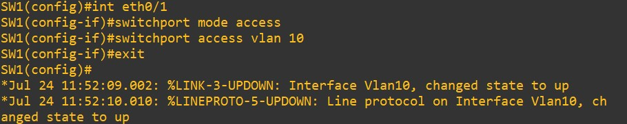

Ahora asignamos la VLAN10 al puerto donde está conectado el equipo W11.

int eth0/1

switchport mode access switchport access vlan 10

exit

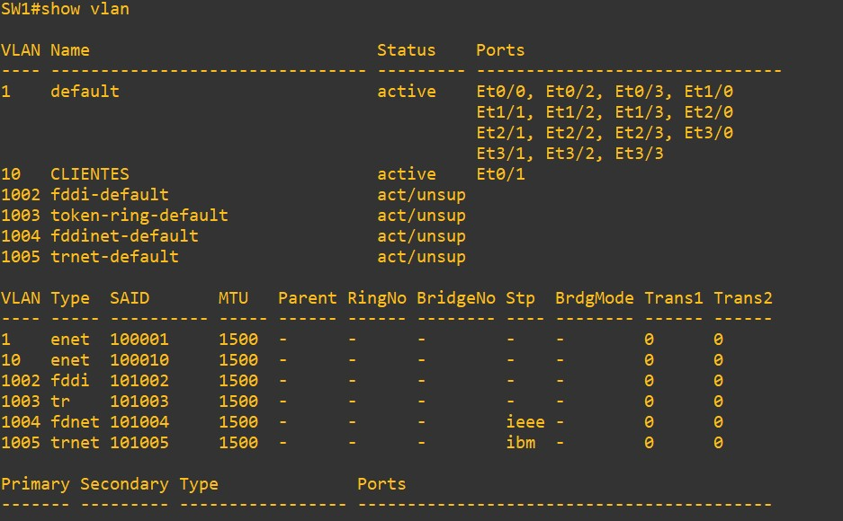

Podemos verificar la VLAN 10 CLIENTES creada, con el comando show vlan, y comprobar que se encuentra creada.

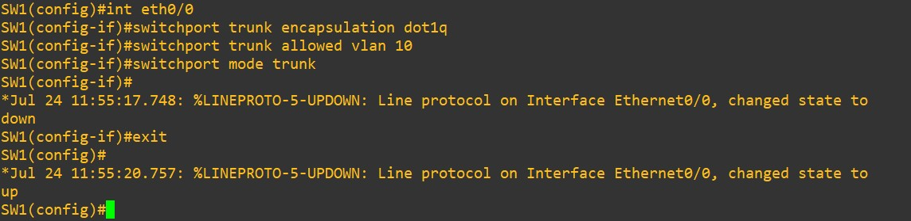

Ahora con los siguientes comandos, debemos de configurar la interfaz eth0/0 en modo troncal, para que el trafico de la VLAN10 llegue al firewall fortinet.

int eth0/0

switchport trunk encapsulation dot1q switchport trunk allowed vlan 10 switchport mode trunk

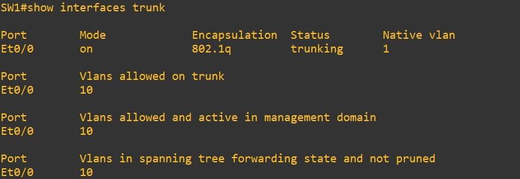

Ahora comprobamos los ajustes de la interfaz troncal con el siguiente comando,

show interfaces trunk

**4.4.Firewall Fortigate**

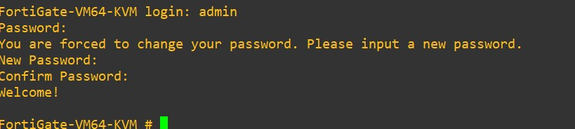

Ahora vamos a proceder a configurar el firewall fortigate, cuando lo iniciemos nos pedirá las credenciales, el usuario predeterminado es Admin, en el primer inicio viene sin contraseña, por lo que debemos de pulsar enter y nos pedirá que introduzcamos una nueva contraseña, una vez introducida ya estaremos en le consola de configuración.

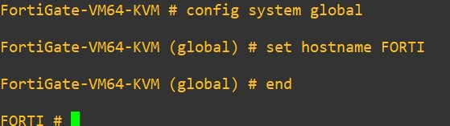

Ahora vamos a proceder a cambiar el nombre host de fortigate con el siguiente comando.

config system global Set hostname FORTI end

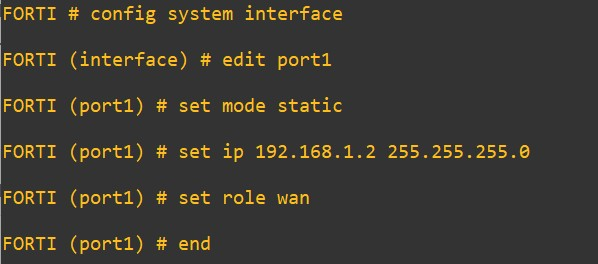

Después de cambiar el nombre host, procedemos a asignar el direccionamiento IP a las interfaces con los siguientes comandos, lo primero vamos a asignar el direccionamiento IP al puerto de la zona WAN y asignarle el rol.

config system interface edit port1

set mode static

set ip 192.168.1.2 255.255.255.0 set role wan

end

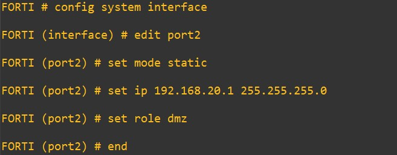

Ahora configuramos el puerto para la zona DMZ.

config system interface edit port2

set mode static

set ip 192.168.20.1 255.255.255.0 set role dmz

end

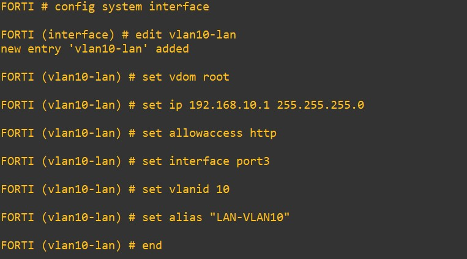

Ahora configuramos el puerto para la zona LAN, creamos la VLAN10 y damos permisos por http, para permitir la administración del firewall por el navegador.

config system interface edit vlan10-lan

set vdom root

set ip 192.168.10.1 255.255.255.0 set allowaccess http

set interface port3 set vlanid 10

set alias "LAN-VLAN10"

end

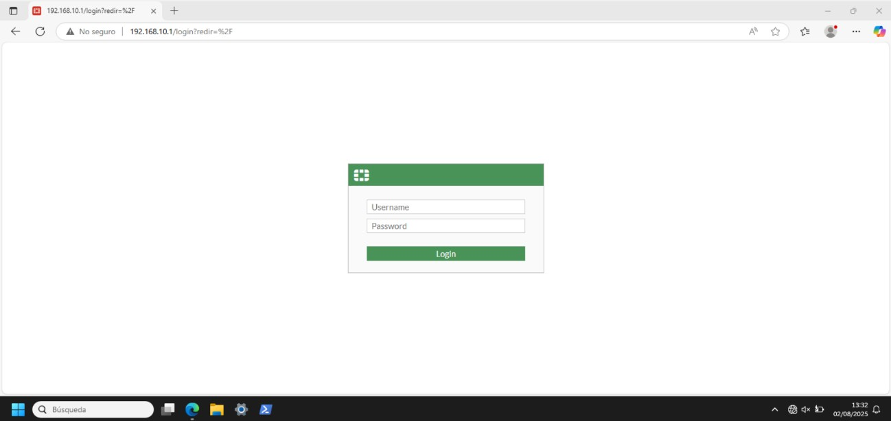

Ahora con el equipo de la zona LAN accedemos vía web a la administración de fortigate y vemos accedemos a la pantalla de inicio e iniciar sesión con las credenciales de admin.

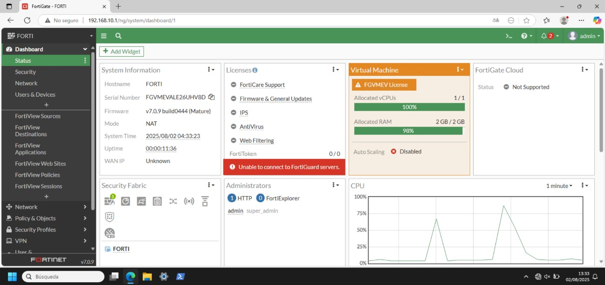

Podemos ver que hemos iniciado sesión.

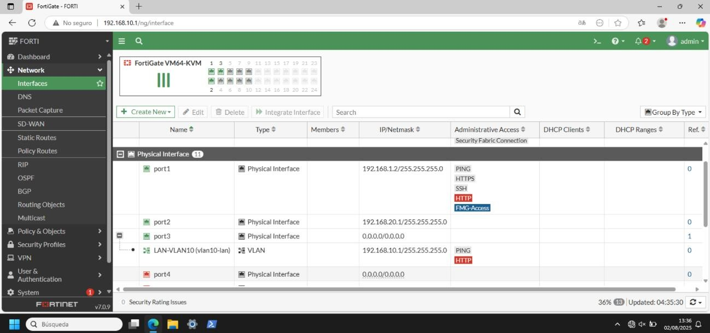

Procedemos ahora a ir a la sección de Network y después a la opción de Interfaces, vemos las interfaces que hemos configurado anteriormente, pulsamos en la interfaz de la VLAN10 para editar los ajustes.

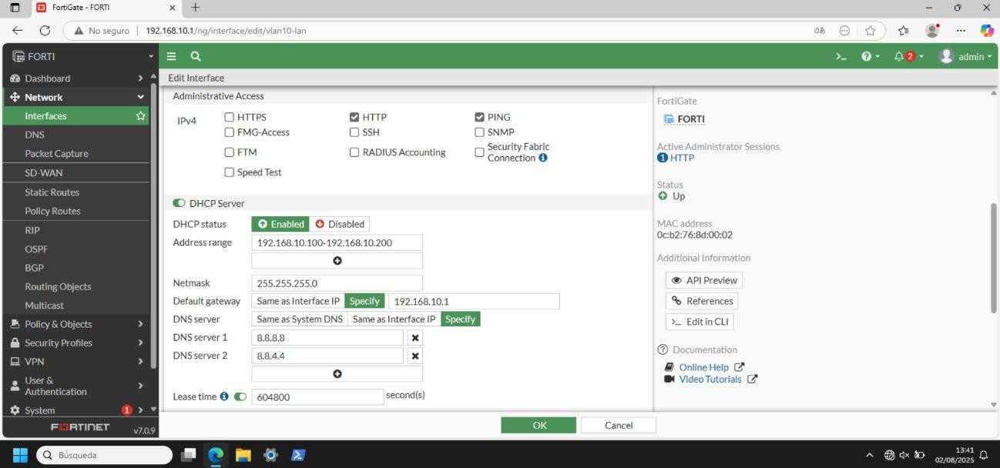

Habilitamos el servicio DHCP, asignamos un rango de dirección, la máscara de red, la puerta de enlace, los servidores DNS y el tiempo de concesión, pulsamos en OK para aplicar los cambios.

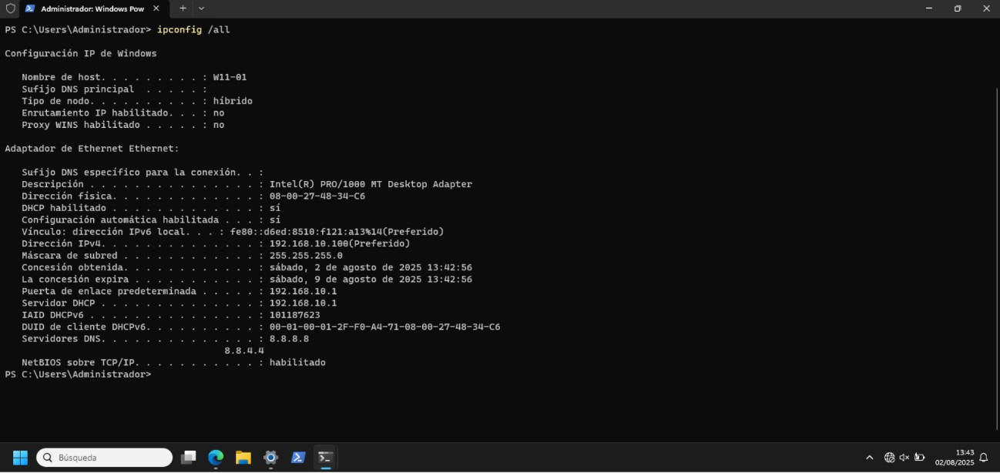

Si ahora el equipo del LAN ponemos el adaptador en DHCP, podemos ver que de manera automática obtiene los parámetros de red que hemos configurado anteriormente en el firewall Fortinet.

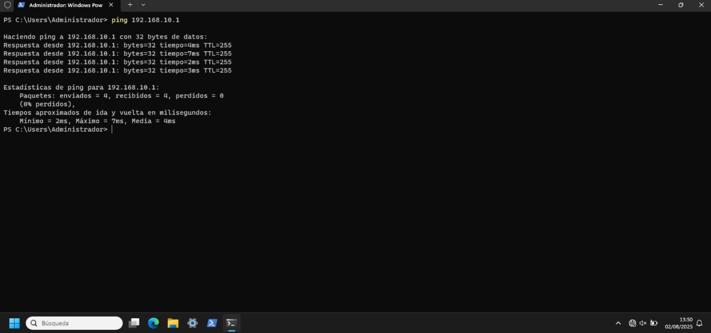

Si hacemos ping a la puerta de enlace, vemos que obtenemos respuesta.

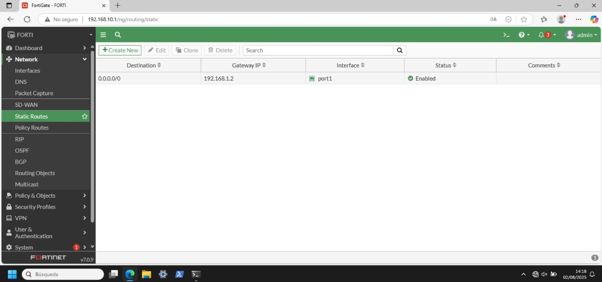

Ahora vamos nuevamente a la administración de Fortinet, y seleccionamos la opción Static Routes, para crear una ruta estática predeterminada hacia el router R1 y que todo el tráfico de la zona LAN llegue a la WAN y pueda salir hacia internet.

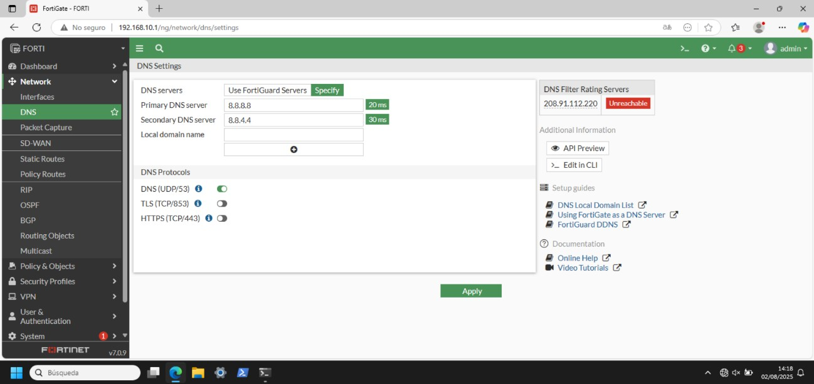

Ahora pulsamos en la opción DNS y en los servidores DNS ponemos las direcciones DNS de google, si está en verde indica que el firewall tiene conexión a internet y puede resolver las peticiones DNS, pulsamos en Apply para guardar los cambios.

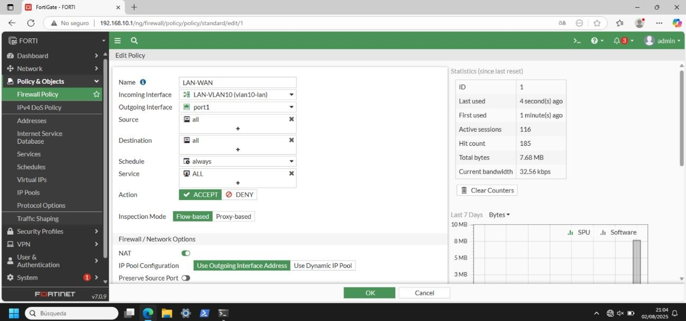

Ahora vamos hacer que la zona LAN tenga conexión a internet, para ello debemos de ir a la sección Policy & Objects y seleccionar la opción Firewall Policy, procedemos a crear una nueva regla firewall en la cual como interfaz de entrada elegimos la VLAN10 y la de salida el port1 correspondiente a interfaz WAN, aceptamos todo el tráfico de origen y de destino al igual que todos los servicios, es importante que la opción NAT este habilitado, pulsamos en OK para aplicar los cambios.

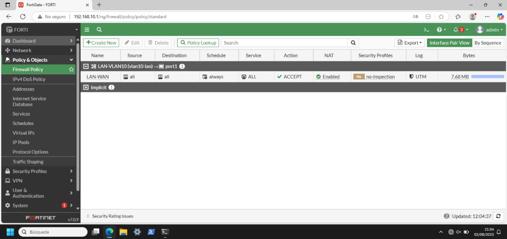

Podemos ver que tenemos aquí la regla firewall ya creada.

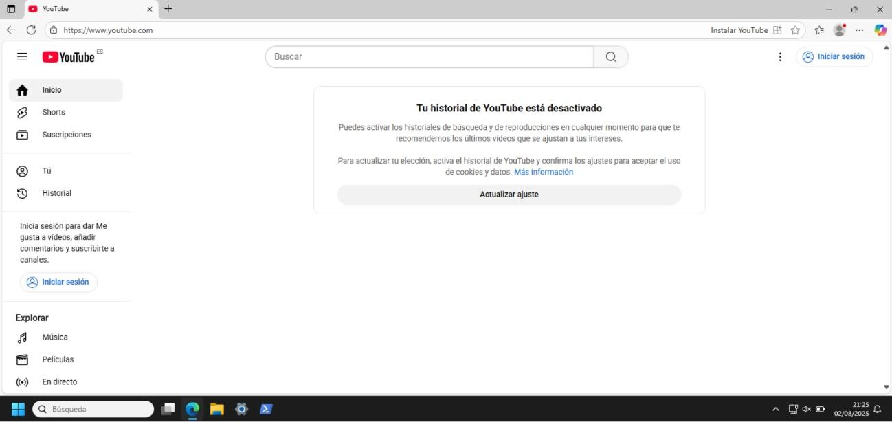

Si ahora accedemos a internet, podemos ver que tenemos conexión a internet desde la zona LAN.

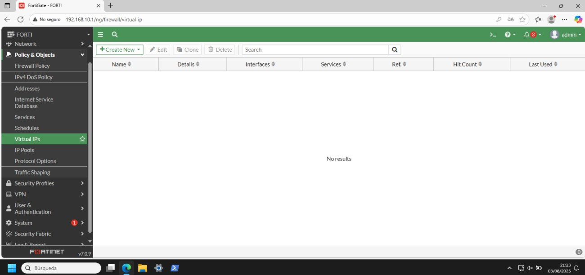

Ahora para que la zona LAN pueda acceder a la DMZ de forma segura y esté aislada de internet, vamos a realizar Port forwarding, para ello debemos de crear primero una IP virtual, para crearla debemos de ir a la sección Policy & Objects, pulsar en la opción Virtual IPs y pulsar en Create New.

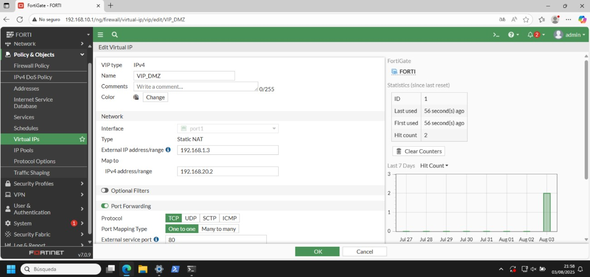

Vamos a asignarle el nombre VIP\_DMZ, dirección IP externa debemos de poner la dirección 192.168.1.3 y después la dirección del servidor DMZ, que en este caso es 192.168.20.2, activamos la opción Port Forwarding, el protocolo seleccionamos el TCP y puerto 80.

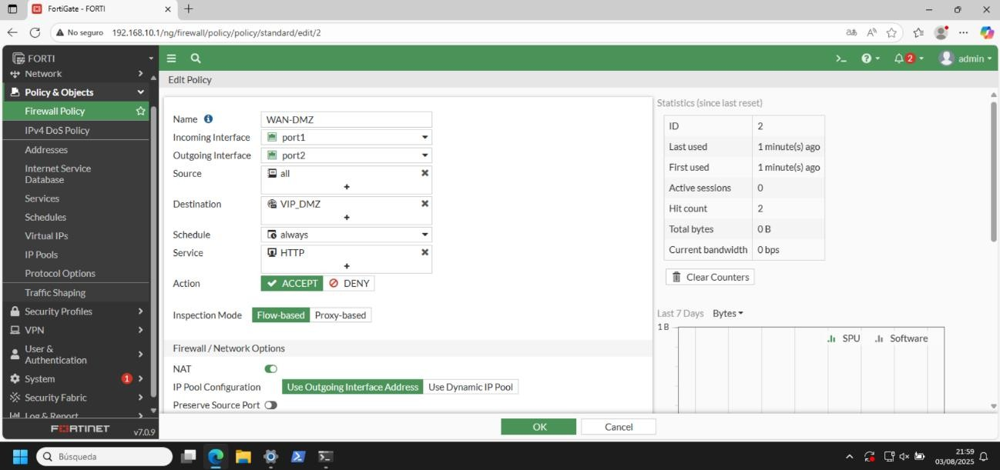

Ahora vamos a crear una nueva regla firewall y vamos a Policy & Objects, Firewall Policy, le asignamos el nombre WAN-DMZ, la interfaz de entrada el puerto 1 correspondiente a la WAN y la interfaz de salida seleccionamos el puerto 2 correspondiente a la DMZ, el trafico de origen seleccionamos todo y el tráfico de destino de debemos de elegir la dirección IP virtual creada anteriormente VIP\_DMZ, el servicio seleccionamos HTTP y el NAT debe de estar habilitado, pulsamos en OK para aplicar los cambios.

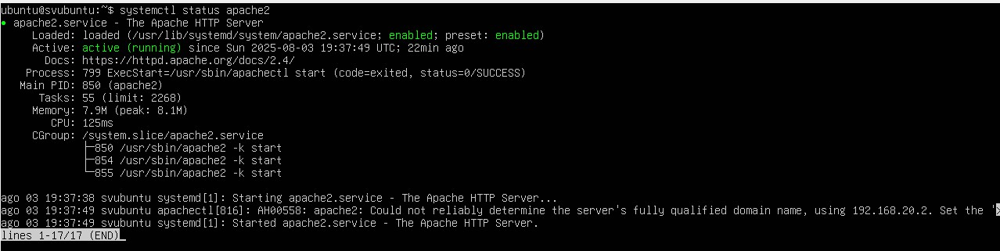

Ahora vamos al servidor DMZ y comprobamos que el servicio apache se encuentra activo.

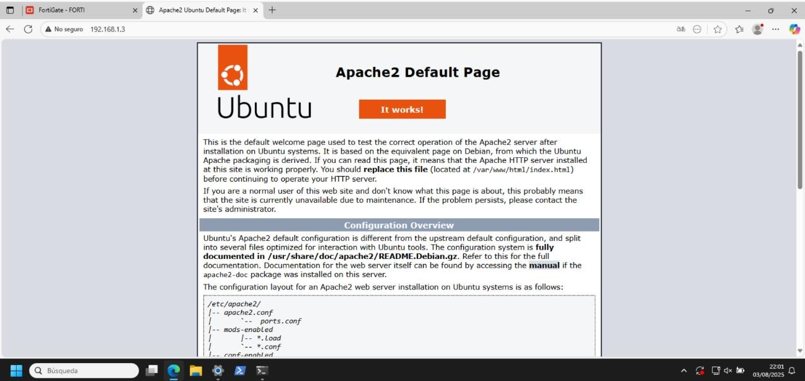

Ahora desde el equipo de la zona LAN, desde el navegador accedemos al servidor web de la DMZ, utilizando la dirección IP virtual 192.168.1.3 y podemos comprobar que hemos accedido de manera correcta.

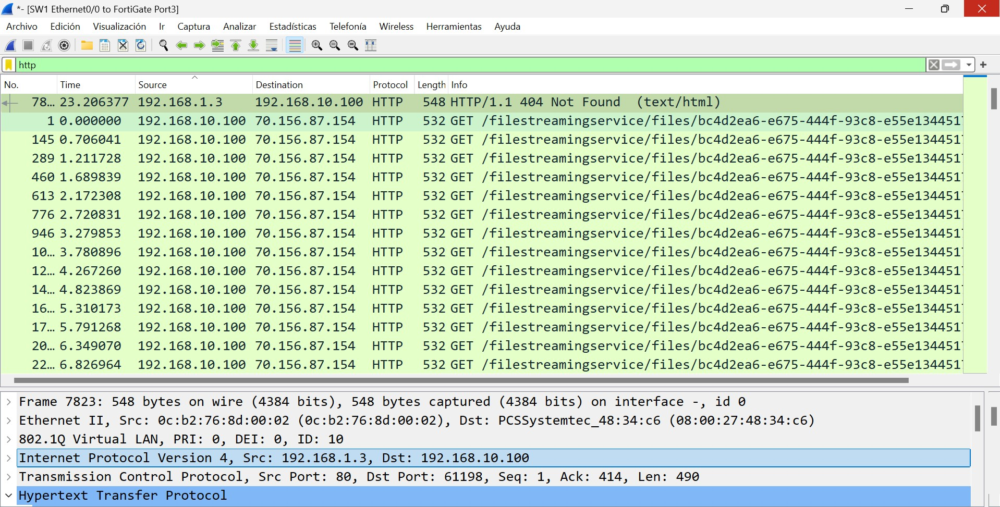

Si capturamos el tráfico en Wireshark podemos ver la conexión HTTP entre la

LAN y la DMZ.
